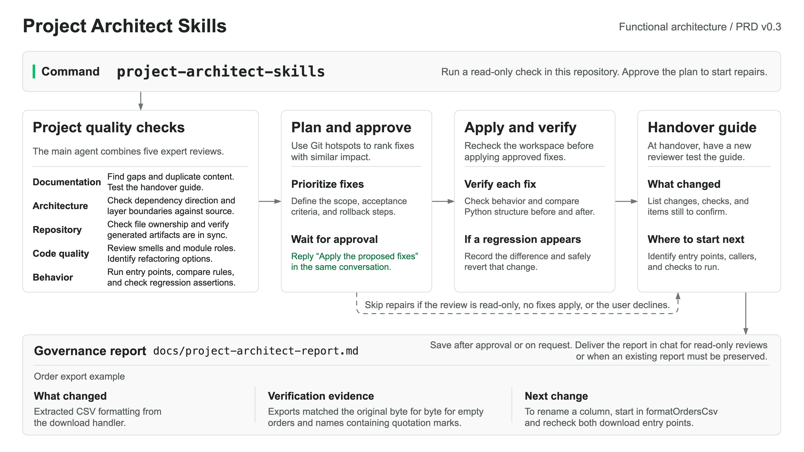

# Project Architect Skills

[](https://github.com/cabbage2000-lab/project-architect-skills/releases/latest)
[](LICENSE)
[](#quick-start)

**English** | [简体中文](README.zh-CN.md)

Keep your codebase under control and easy to maintain as your AI-assisted development (vibe coding) project grows more complex.

Project Architect is a skill for **Codex, Claude Code, and WorkBuddy**. It checks documentation, architecture diagrams, repository layout, code quality, and the behavior of a representative user entry point. Before a handover or a change, it helps you find where to start, which callers depend on the current behavior, and how to verify the result.

## How it works

Project quality checks answer five engineering questions: can maintainers follow the instructions, understand dependencies, find files in the right place, change the code safely, and verify that the feature works? Each reviewer gathers evidence from source code, documentation, configuration, and tests. The main agent combines the findings; Python scripts validate the records and generate the results.

| Quality check | Reviewer | What it checks | Why it matters |
| --- | --- | --- | --- |
| Essential documentation | Engineering documentation expert | Missing or repeated instructions, broken references, and runnable setup and verification steps | Gives maintainers and AI a reliable starting point and reduces mistakes caused by outdated or conflicting instructions. |
| Architecture diagrams and dependencies | Software architecture expert | Diagram relationships against source code, dependency direction, and agreed layer boundaries | Identifies affected modules and callers so a change does not overlook dependencies or violate the project's architecture. |
| Repository structure | Repository structure expert | Directory rules, file ownership, and the effects of moving files on imports, builds, and test discovery | Keeps files discoverable by both people and tools, including tests that could otherwise be silently skipped. |
| Code quality | Code quality expert | Method smells, module responsibilities, and evidence-backed refactoring opportunities | Exposes tangled responsibilities, complex branches, and repeated rules that make changes harder and regressions more likely. |
| Behavior verification | Behavior verification expert | Samples through a real entry point, business rules, and regression assertions | Confirms that the feature works as agreed and that the normal tests can catch a regression in that behavior. |

The checks complement one another. For example, the structure reviewer can locate a test outside the discovery directory, while the behavior reviewer confirms which test the normal command misses. The main agent combines these observations into one repair item and retains both sources of evidence.

The behavior reviewer can compare the same rule across entry points, replay a data migration and recovery, exercise concurrent writes, verify access boundaries, or diagnose a controlled failure. The structure reviewer can rebuild a generated artifact and check what its consumer receives. At handover, a fresh documentation reviewer or the recipient can use the guide to locate a related change and run a check that would catch a regression.



[Editable diagram](docs/diagrams/product-functional-architecture.en.drawio) · [Full workflow](skills/project-architect-skills/SKILL.md#治理流程)

A full quality check covers all five areas; a focused request checks only the relevant modules or entry points. Inspection and planning stay read-only. The conversation shows a check table and a one-sentence conclusion, with proposed scope and acceptance criteria when repairs are needed. Changes require approval and are then verified individually. Inconclusive findings remain marked as needing confirmation.

## Quick start

**1. Install the skill.** Open the project you want to inspect and give your coding assistant this prompt.

> Install the project-architect-skills skill from https://github.com/cabbage2000-lab/project-architect-skills in the current project.

**2. Run a project quality check.** Start a new conversation in the same project. In Claude Code, enter this command.

```text
/project-architect-skills Run a full project quality check
```

The Chinese prompt is `/project-architect-skills 项目质检`. In Codex or WorkBuddy, say “Use project-architect-skills to run a full project quality check.”

The first pass is read-only. The behavior reviewer follows one user entry point through a minimal run, a documented business rule, and the relevant test assertions. The report identifies which checks ran and which relied on source inspection. The report shows the evidence for each finding, explains which maintenance task it affects, and suggests what to fix first. Reply “Apply the proposed fixes” or `同意治理` to approve the plan. You can also name just the items you want fixed.

<details>
<summary>Project-level installation paths</summary>

Copy the entire `skills/project-architect-skills/` folder from this repository into the appropriate directory in the target project. This repository uses relative symlinks so you can also try it directly in a checkout that preserves them.

| Tool | Directory in the target project | How to invoke the skill |
| --- | --- | --- |
| Codex | `.agents/skills/` | `project-architect-skills` |
| Claude Code | `.claude/skills/` | `/project-architect-skills` |
| WorkBuddy Desktop | `.workbuddy/skills/` (tested on macOS with WorkBuddy 5.11.3) | `Use project-architect-skills to assess this project.` |

For a WorkBuddy project using `.codebuddy/` configuration, copy the skill into `.codebuddy/skills/`. In the chosen directory, `project-architect-skills/SKILL.md` should sit alongside the `agents/`, `references/`, and `scripts/` directories. [Claude Code skills](https://code.claude.com/docs/en/skills) · [WorkBuddy project configuration](https://www.codebuddy.cn/docs/workbuddy/From-Beginner-to-Expert-Guide/Function-Description/Project#项目级代码开发配置)

</details>

## Usage examples

Choose a prompt that matches what you need to do. In Codex or WorkBuddy, replace the leading `/project-architect-skills` with `Use project-architect-skills to`.

| When to use it | Claude Code prompt |
| --- | --- |
| Full project quality check | `/project-architect-skills Run a full project quality check` |
| Behavior verification | `/project-architect-skills Verify the empty-order export and check whether the normal test suite would catch a missing header` |
| Compare entry points | `/project-architect-skills Compare sales totals on the orders page and in the reconciliation export using the same cancelled order` |
| Generated artifacts | `/project-architect-skills Verify that the SDK customers install matches the current API definition` |
| Independent handover | `/project-architect-skills Independently verify that a maintainer can use the export guide to check a column rename` |
| Pre-commit change check | `/project-architect-skills Check my uncommitted changes for affected callers, outdated docs, and missing tests` |
| Review a commit range | `/project-architect-skills Check the changes in main...feature` |
| Documentation quality check | `/project-architect-skills Run a documentation quality check` |
| Check for missing documentation | `/project-architect-skills List the essential documents this project is missing and explain why each should be added` |
| Add documentation with recommendations | `/project-architect-skills Add documentation` |
| Write a specific guide | `/project-architect-skills Write a local setup guide with steps to start the project and verify it works` |
| Architecture diagram quality check | `/project-architect-skills Run an architecture diagram quality check` |
| Check for missing architecture diagrams | `/project-architect-skills List the essential architecture diagrams this project is missing and explain why each should be added` |
| Get diagram recommendations | `/project-architect-skills Add architecture diagrams` |
| Draw a specific diagram | `/project-architect-skills Use the source code to draw an architecture diagram showing the main modules and how they call one another` |
| Project structure check | `/project-architect-skills Run a project structure check` |
| Refactoring review | `/project-architect-skills Identify code worth refactoring, explain why, and suggest how to verify the changes` |

Just ask to “Add documentation.” The assistant checks where someone would get stuck, explains which addition would help most, and suggests where to put it. A small tool might need one line in the README showing the expected output. If buyers and support staff follow different order cancellation rules, the assistant checks whether those rules belong in an existing guide or need a product requirements document for review. It writes the additions you choose and tells you when the existing guides already cover the task. [When the skill recommends each of the seven document types](skills/project-architect-skills/references/necessary-documents.md#补文档)

You can also ask to “Add architecture diagrams.” If colleagues know how to request an export but cannot tell when the file is ready, the assistant traces the request and checks existing diagrams before recommending a view of the handoff. If an existing diagram only needs a corrected arrow, it identifies that edit. It draws the changes you choose or explains why the existing material is sufficient. [When the skill recommends each diagram type](skills/project-architect-skills/references/architecture-diagrams.md#补架构图)

A change check reviews staged, unstaged, and non-ignored untracked files in read-only mode. It reports what behavior changed, which consumers or instructions are affected, and what still needs verification. Use `A..B` to compare two committed snapshots or `A...B` to review changes from the common ancestor to B.

## Project background

As AI coding tools become widely available, anyone can write code, and projects can quickly move from an idea to active development. As a project goes through more iterations and its codebase grows, AI starts to struggle. For complex features, AI often needs several rounds of clarifying questions to understand the context, and the logic or implementation can easily drift from the original intent.

AI rarely takes the initiative to maintain a project's architecture. It seldom refactors code, revisits architectural decisions, cleans up code smells, or checks for missing documentation and references on its own. These repetitive, time-consuming engineering tasks often become bottlenecks as a project evolves. Given clear instructions, AI can handle them well.

Software professionals build these engineering and architecture skills on a strong foundation in computer engineering. Developers without that background may find it hard to do this work on their own. This project helps bridge that gap by giving AI a structured way to carry out these tasks, so vibe coding stays smooth and efficient as projects grow.

## Reading the report

By default, the conversation shows a compact table with each check, its pass status, and a short explanation, followed by one sentence stating whether repairs are needed. Findings name the problem directly, such as a README command pointing to a deleted file. Ask for details to expand the evidence, repair plan, and maintenance guide.

The report uses `待确认` (needs confirmation) when evidence is missing. For example, if a test manual is inaccessible, the report identifies the steps that still need checking. When Git rules exclude confidential documents or diagrams from the checkout, their delivery check is marked `不适用` (not applicable). Verified errors in public instructions still appear as findings.

Ask “Show the detailed report” to expand the evidence, or “Save this report” to keep the complete report. The assistant also saves the report by default after approved repairs. When saving succeeds, the reply includes the path `docs/project-architect-report.md`. If a manually maintained report already exists there, the assistant preserves it. If saving is unavailable, the assistant shares a summary in the conversation, where you can also ask for the full report. [Example from an earlier documentation review](docs/examples/necessary-docs-report.md)

## Testing

Run the test suite from the root of this repository. The complete suite requires Python 3.10 or later and Git on your `PATH`. The Python code uses the standard library.

```sh
python3 -B -m unittest discover -s tests -v
```

The final line is `OK` when all tests pass. If it reads `OK (skipped=N)`, check the reasons next to the skipped cases. For example, Python 3.9 skips the pattern-matching test, and the Git history tests require Git.

The [order handover exercise](docs/examples/order-handover/README.md) includes two CSV consumers, a historical archive, and an observer check for the five-person pilot.

<details>
<summary>Try a read-only documentation check</summary>

Create a temporary project with a working usage example.

```sh
smoke_project=$(mktemp -d)
cat > "$smoke_project/README.md" <<'EOF'
# Name list

Run `python3 names.py` from the project root to print the sorted names.
EOF
cat > "$smoke_project/names.py" <<'EOF'
names = ["Bob", "Ada", "Bob"]
print(", ".join(sorted(set(names))))
EOF
printf '%s\n' "$smoke_project"
```

From a conversation opened in **this** repository, ask “Use project-architect-skills to check the handover documentation in `<temporary project path>`. Keep the check read-only.” Substitute the path printed above. The initial response should contain a compact table marking documentation as failed because expected verification output is missing, followed by one sentence. Then ask for the detailed report and verify the following.

- The usage check should cite the working example and report `范围内未发现` (no issue found in scope).
- The verification check should report `发现问题` (issue found). The README tells readers how to run the program but does not tell them what output to expect. The suggested addition should identify `Ada, Bob` as the expected result.
- Run `ls -A "$smoke_project"`. The directory should still contain only `README.md` and `names.py`.

</details>

<details>
<summary>Try the repair workflow in a temporary Codex project</summary>

From this repository's root, create a project with two independently verifiable issues. Its README lacks acceptance instructions and its test file sits outside the directory specified in its own project guidelines.

```sh
governance_project=$(mktemp -d)
mkdir -p "$governance_project/.agents/skills"
cp -R skills/project-architect-skills "$governance_project/.agents/skills/"
cat > "$governance_project/AGENTS.md" <<'EOF'
# Project conventions

This project maintains names.py and its tests. Run names.py from the project root.
Unit tests belong in tests/. Installed skills live in .agents/skills/.
EOF
cat > "$governance_project/README.md" <<'EOF'
# Name list

Run `python3 -B names.py` from the project root to print the unique names in alphabetical order.
EOF
cat > "$governance_project/names.py" <<'EOF'
names = ["Bob", "Ada", "Bob"]
print(", ".join(sorted(set(names))))
EOF
cat > "$governance_project/test_names.py" <<'EOF'
import subprocess
import sys
import unittest


class NamesTests(unittest.TestCase):
    def test_names(self):
        output = subprocess.check_output([sys.executable, "-B", "names.py"], text=True)
        self.assertEqual(output.strip(), "Ada, Bob")
EOF
git -C "$governance_project" init -q
git -C "$governance_project" add .
git -C "$governance_project" -c user.name=Fixture -c user.email=fixture@example.invalid \
  commit -qm 'Save fixture baseline'
(cd "$governance_project" && python3 -B names.py && python3 -B -m unittest discover -s . -p test_names.py)
printf '%s\n' "$governance_project"
```

Open the printed path in a writable Codex session and enter `project-architect-skills`. When the host supports subagents, check that all five reviewers load their definitions and return findings before the plan appears. The plan should identify `README.md` and `test_names.py`. At this point, `git status --short` in the temporary project should produce no output.

Approve the two repairs in the same conversation. Verify each result in the temporary project.

- `README.md` includes a verification command and its expected result. The test has moved to `tests/`.
- `python3 -B names.py` still prints `Ada, Bob`. Running `python3 -B -m unittest discover -s tests` runs and passes one test.
- `docs/project-architect-report.md` covers the five assessments, the baseline and verification result for each repair, and guidance for the next maintainer.

To check the decline path, create a fresh fixture and decline the proposed repairs. The session should deliver the findings and recommendations, and `git status --short` should still produce no output.

</details>

## License

Released under the [MIT License](LICENSE).
