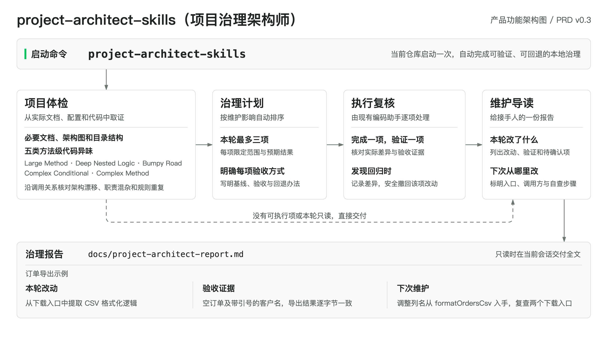

# 项目治理架构师

[](https://github.com/cabbage2000-lab/project-architect-skills/releases/latest)
[](LICENSE)
[](#快速开始)

[English](README.md) | **简体中文**

专门解决 AI 辅助开发（Vibe Coding）进入深水区后，项目容易失控、难以维护的痛点。

## 项目背景

随着 AI 编程能力的普及，人人皆可编码，项目往往从一个灵感（Idea）起步便迅速进入研发阶段。然而，随着项目的不断迭代与代码量的激增，当系统达到一定体量后，AI 的介入往往会显得力不从心。面对复杂的功能需求，AI 常常需要多轮追问才能理解上下文，且极易出现逻辑漂移或实现偏差。

究其根本，是因为当前的 AI 缺乏主动的架构治理意识——它不会主动进行代码重构、架构设计，也难以自发地清理代码坏味道或检查文档与引用的缺失。这些重复且耗时的工程化操作，往往是项目演进的瓶颈。当然，一旦我们下达明确的指令，AI 能够出色地完成这些任务。

这些专业的工程化与架构设计能力，通常是具备深厚计算机工程基础的专业人员所必备的，但对于非专业开发者而言，往往难以独立驾驭。这正是本项目的初衷：通过系统化的治理手段弥补这一鸿沟，引导 AI 主动执行这些关键操作，让 Vibe Coding 在项目规模化后依然能够顺畅、高效地运转。

## 项目原理

项目质检围绕五个工程问题展开：说明能否照做、依赖是否清晰、文件归属是否正确、代码是否容易修改、功能行为是否可靠。对应专家分别从源码、文档、配置和测试中取证，主 Agent 汇总问题与影响，Python 脚本校验记录并生成结果。

### 检查什么，为什么要检查

| 质检项 | 负责专家 | 检查什么 | 为什么要检查 |
| --- | --- | --- | --- |
| 必要文档 | 工程文档专家 | 文档缺漏、重复内容和失效引用，启动与验证步骤是否可执行 | 让接手者和 AI 能找到真实入口、照说明运行，减少过期或矛盾说明造成的误改。 |
| 架构图与依赖 | 软件架构专家 | 用源码核对图中关系、依赖方向和项目认可的分层边界 | 弄清修改会影响哪些模块和调用方，避免沿旧图漏查依赖或破坏分层约定。 |
| 目录结构 | 仓库结构专家 | 目录约定、文件归属，以及移动文件对导入、构建和测试发现的影响 | 让文件能被维护者找到、被工具正确加载，避免测试放错目录后悄悄漏跑。 |
| 代码质量 | 代码质量专家 | 方法异味、模块职责和有依据的重构机会 | 找出职责混杂、复杂分支或重复规则带来的修改负担，降低漏改和引入回归的风险。 |
| 行为验证 | 行为验证专家 | 从真实入口重放样例，核对业务规则和回归断言 | 确认功能确实能用、结果符合约定，并确认常用测试能发现关键行为的回归。 |

五项检查相互补充。例如，测试文件放在发现目录之外，目录结构检查能定位归属错误，行为验证能确认常用测试命令漏跑了哪个用例。主 Agent 将同一问题合并为一个修复项，保留两处依据，避免重复治理。

行为验证可按项目实际能力核对跨入口规则、存量数据迁移与恢复、并发写入、权限与数据隔离、失败可诊断性。仓库结构专家可从修改源重新生成产物，核对消费者拿到的版本。正式交接时，可让未参与拟稿的工程文档专家或实际接手者凭导读完成一项相邻维护验证。[行为专项](skills/project-architect-skills/references/behavior-verification.md#按业务约定触发的专项) · [交接复验](skills/project-architect-skills/references/execution-and-handover.md#维护导读独立复验)

### 从质检到修复



[查看可编辑图源](docs/diagrams/product-functional-architecture.drawio) · [完整工作流程](skills/project-architect-skills/SKILL.md#治理流程)

全面质检覆盖五项，专项问题只查相关模块或入口。检查和计划预览保持只读，会话默认给出质检表和一句话总结；有问题时列明拟改范围与验收标准，获得授权后再逐项修复、复核。证据不足的项标为「待确认」，不将猜测当作修复依据。

## 快速开始

**1. 让 AI 安装。** 用 Codex、Claude Code 或 WorkBuddy 打开你想检查的项目，把下面这句话发给 AI。

> 请帮我把「项目治理架构师」安装到当前项目，装好后告诉我。项目地址是 https://github.com/cabbage2000-lab/project-architect-skills

**2. 运行项目质检（最常用）。** 安装好后，在目标项目里新开对话。在 Claude Code 中输入下面这条命令。

```text
/project-architect-skills 项目质检
```

在 Codex 或 WorkBuddy 中，也可以直接输入「项目评估」。

质检先只读检查工程文档、软件架构、仓库结构、代码质量和关键行为。结果默认显示「质检项／是否通过／说明」表格和一句话总结，直接告诉你有没有需要修复的问题。行为验证默认沿一条代表性入口核对最小运行、业务预期和测试断言。需要修复时，助手另列改动范围和验收标准；回复 **同意治理** 即可开始，也可以只选其中几项。

<details>
<summary>供 AI 安装时查看</summary>

将来源项目中的 `skills/project-architect-skills/` 整个复制到目标项目的技能目录。本仓库通过相对符号链接提供各工具的入口，Git 检出时保留符号链接即可直接试用。

| 工具 | 目标项目中的技能目录 | 新会话中显式调用 |
| --- | --- | --- |
| Codex | `.agents/skills/` | `project-architect-skills` |
| Claude Code | `.claude/skills/` | `/project-architect-skills` |
| WorkBuddy 桌面端 | `.workbuddy/skills/`（macOS 5.11.3 实测） | `用 project-architect-skills 评估当前项目` |

WorkBuddy 使用 `.codebuddy/` 项目级代码开发配置时，复制到 `.codebuddy/skills/`。安装后，从所选目录打开 `project-architect-skills/SKILL.md`，确认旁边有 `agents/`、`references/` 和 `scripts/`。[Claude Code 技能说明](https://code.claude.com/docs/en/skills) · [WorkBuddy 项目配置](https://www.codebuddy.cn/docs/workbuddy/From-Beginner-to-Expert-Guide/Function-Description/Project#项目级代码开发配置)

</details>

## 使用示例

按手头的任务选一条提示词。在 Codex 或 WorkBuddy 中，把开头的 `/project-architect-skills` 换成「用 project-architect-skills」。

| 使用场景 | Claude Code 提示词 |
| --- | --- |
| 全面质检 | `/project-architect-skills 全面质检` |
| 行为验证 | `/project-architect-skills 只做行为验证，检查空订单导出的结果，以及现有测试能否发现表头丢失` |
| 跨入口规则 | `/project-architect-skills 用同一组含取消订单的数据，核对订单页与对账导出的销售额` |
| 生成产物 | `/project-architect-skills 核对接口定义生成的 SDK 与用户安装到的版本是否同步` |
| 交接复验 | `/project-architect-skills 对订单导出的维护导读做独立复验，看接手者能否验证列名调整` |
| 提交前检查 | `/project-architect-skills 本次改动质检，看看这次改动漏了哪些调用方、文档或测试` |
| 检查提交范围 | `/project-architect-skills 本次改动质检，检查 main...feature` |
| 文档质检 | `/project-architect-skills 文档质检` |
| 本项目缺失文档检查 | `/project-architect-skills 本项目缺哪些必要文档，列出建议补写项和依据` |
| 补文档，请助手推荐 | `/project-architect-skills 补文档` |
| 补指定文档 | `/project-architect-skills 补一份本地启动指南，写清启动和验证步骤` |
| 架构图质检 | `/project-architect-skills 架构图质检` |
| 本项目缺失架构图检查 | `/project-architect-skills 本项目缺哪些必要架构图，列出建议补画的图和依据` |
| 补架构图，请助手推荐 | `/project-architect-skills 补架构图` |
| 画指定的图 | `/project-architect-skills 根据源码补一张架构图，画清主要模块及调用关系` |
| 项目结构检查 | `/project-architect-skills 项目结构质检` |
| 代码重构检查 | `/project-architect-skills 找出值得重构的代码，给出理由和验证方法` |

只说「补文档」就可以。助手会先看项目，指出谁在哪一步会遇到困难、最值得补哪段、写在哪里。小工具可能只需在 README 加一行预期输出。如果买家和客服取消订单的规则不同，团队又需要一起验收，助手会说明该补现有章节，还是单独写一份产品需求文档（PRD）。你选定后再写入，已有说明够用时会直接告诉你。[七类文档分别在什么情况下推荐](skills/project-architect-skills/references/necessary-documents.md#补文档)

只说「补架构图」也可以。比如，同事知道去哪里点「导出」，却不清楚提交后谁生成文件，助手会先核对入口、后台任务和已有图，再建议是否画出这段先后顺序。如果只是原图漏了一个环节，会指出该改哪张图、哪条线。你选定后再画，已有材料够用时会说明原因。[架构图分别在什么情况下推荐](skills/project-architect-skills/references/architecture-diagrams.md#补架构图)

本次改动质检默认只读检查已暂存、未暂存和未被 Git 忽略的新文件。报告列出行为变化、受影响的位置和提交前还需执行的验证。指定 `A..B` 比较两个提交的内容，`A...B` 检查从共同祖先到 B 的改动。[本次改动质检](skills/project-architect-skills/references/change-check.md)

## 怎样读质检报告

默认先看一张简表，每个质检项一行，列明是否通过和简短说明；表后用一句话说明是否需要修复。有问题时直接写清问题，例如「README 启动命令指向已删除文件」。只有你要求详情时，才展开完整证据、计划和维护导读。

「待确认」表示证据还不足以判断。例如，测试手册无法访问时，报告会标明哪些验证步骤仍需核实。若已确认保密文档或图件因 Git 忽略规则未随仓库交付，其交付检查记为「不适用」。公开资料里已核实的失效步骤仍会列出。

可以说「查看详细报告」展开依据，或说「请保存这次报告」保存完整报告。同意修复后也会默认保存。保存成功时，会话会附上路径 `docs/project-architect-report.md`。如果该路径已有人手工维护的报告，助手会保留原文件。无法保存时，会话仍提供摘要，也可以按需查看全文。 [查看早期必要文档专项报告示例](docs/examples/necessary-docs-report.md)

## 验证模块

如果你修改了这个 Skill，可以在本仓库根目录运行全部测试。完整测试需要 Python 3.10+ 和可从 `PATH` 调用的 Git，只用 Python 标准库。

```sh
python3 -B -m unittest discover -s tests -v
```

最后一行显示 `OK` 表示全部用例通过。`OK (skipped=N)` 表示有 N 项跳过，原因在对应的用例旁。例如 Python 3.9 会跳过模式匹配测试，找不到 Git 会跳过 Git 历史测试。

双调用方交接样板附有可运行的订单、对账和旧版归档命令。观察员可以独立验收三个入口，并用同一基线组织五人试点。[运行样板和试点](docs/examples/order-handover/README.md)

<details>
<summary>在任一支持的工具中验证只读检查</summary>

修改 `SKILL.md` 或检查判据后，可用一份有运行说明的临时项目检查取证和报告交付。先在终端创建样例。

```sh
smoke_project=$(mktemp -d)
cat > "$smoke_project/README.md" <<'EOF'
# 姓名整理

把一组姓名整理成列表。在项目根目录用 Python 3 运行 `python3 names.py`。
EOF
cat > "$smoke_project/names.py" <<'EOF'
names = ["Bob", "Ada", "Bob"]
print(", ".join(sorted(set(names))))
EOF
printf '%s\n' "$smoke_project"
```

在以本仓库为工作目录的会话中输入「用 project-architect-skills 只读检查 `<临时目录路径>` 的必要文档」，将占位符换成终端输出的路径。会话应先给出简表，「必要文档」为「未通过」，说明缺少验证结果，并用一句话总结。再要求「查看详细报告」，复核以下三点。

- 「启动或最小使用示例」显示「范围内未发现」，依据指向临时项目的运行说明。
- 「验证改动的方法」显示「发现问题」，缺口类型为「缺少说明」。补写建议指向临时项目的 `README.md`，可记录运行后的预期输出 `Ada, Bob`。
- 终端执行 `ls -A "$smoke_project"`，目录清单应只有 `README.md` 和 `names.py`。

</details>

<details>
<summary>在临时仓库验证默认治理（以 Codex 为例）</summary>

在本仓库根目录运行以下命令。这个样例的 README 缺少验收说明，单元测试也放错了目录，两项修复可以分别验收。

```sh
governance_project=$(mktemp -d)
mkdir -p "$governance_project/.agents/skills"
cp -R skills/project-architect-skills "$governance_project/.agents/skills/"
cat > "$governance_project/AGENTS.md" <<'EOF'
# 样例仓库约定

本项目只维护 `names.py` 及其测试。`names.py` 是仓库根目录的命令行入口，单元测试固定放在 `tests/`。`.agents/skills/` 存放已安装的工具。
EOF
cat > "$governance_project/README.md" <<'EOF'
# 姓名整理

对内置姓名去重并按字母顺序排列。在仓库根目录运行 `python3 -B names.py`。
EOF
cat > "$governance_project/names.py" <<'EOF'
names = ["Bob", "Ada", "Bob"]
print(", ".join(sorted(set(names))))
EOF
cat > "$governance_project/test_names.py" <<'EOF'
import subprocess
import sys
import unittest


class NamesTests(unittest.TestCase):
    def test_names(self):
        output = subprocess.check_output([sys.executable, "-B", "names.py"], text=True)
        self.assertEqual(output.strip(), "Ada, Bob")
EOF
git -C "$governance_project" init -q
git -C "$governance_project" add .
git -C "$governance_project" -c user.name=Fixture -c user.email=fixture@example.invalid \
  commit -qm '保存样例基线'
(cd "$governance_project" && python3 -B names.py && python3 -B -m unittest discover -s . -p test_names.py)
printf '%s\n' "$governance_project"
```

在可写的 Codex 会话中打开输出的临时目录，输入 `project-architect-skills`。在支持子 Agent 的宿主中，核对五项质检是否各自加载了对应的专家定义，并有独立的派发与回传记录，计划在汇总后统一展示。核对质检摘要和待授权计划，列出的两项分别指向 `README.md` 和 `test_names.py`。在临时仓库根目录运行 `git status --short`，应无输出。随后在同一会话回复 **同意治理**，完成后核对以下结果。

- `README.md` 增加验收步骤及预期输出。`test_names.py` 移到 `tests/`。
- 在临时仓库根目录运行 `python3 -B names.py`，仍输出 `Ada, Bob`。运行 `python3 -B -m unittest discover -s tests`，1 项通过。
- `docs/project-architect-report.md` 包含五项质检、两项已通过的执行复核和维护导读。两项改动都有各自的改前基线和验收证据。

另建一份相同的临时仓库，收到授权提示后回复「不同意治理」。会话应交付检查结果和未执行的建议，`git status --short` 仍无输出。

</details>

## 开源协议

本项目采用 [MIT 许可证](LICENSE)。
