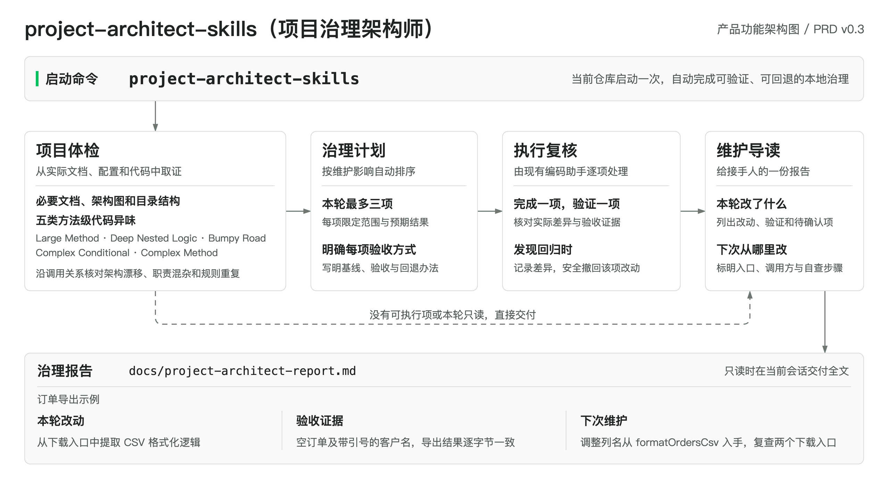
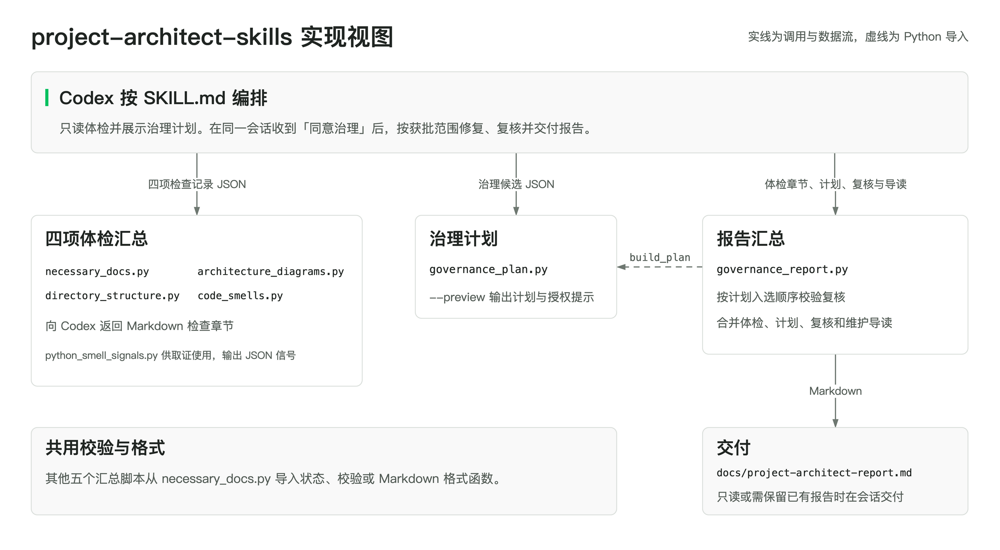

# project-architect-skills（项目治理架构师）

**产品需求文档 · v0.3 评审稿**

文件按 `{项目名称}-PRD-v{版本号}.md` 命名，升版时同步更新文件名与文首版本号。

## 1. 产品定位与目标

项目治理架构师用于 AI 辅助开发项目的事后治理。项目可以跨多个会话快速积累功能，但早期对模块边界和业务例外的解释可能只留在旧对话里。到了第一次交接，或一次看似很小的修改开始牵动多个模块时，接手人往往会问「这个功能从哪里进？改这里会影响谁？我怎么知道改对了？」

产品从仓库的文档、架构图、目录和代码中找出妨碍接手的问题，把值得处理的问题纳入治理计划。用户确认后，编码助手逐项执行与验证，并交付新手下次用得上的模块导读。**成功标准是新手能独立完成下一次同类维护，并说清自己的判断依据。**

### 目标用户与使用场景

| 使用者 | 典型请求 | 期望结果 |
| --- | --- | --- |
| 第一次接手项目的新手，能启动项目和使用编码助手 | 「我要改订单导出的列名，应该从哪里看？」 | 找到业务入口、列定义、受影响的调用方，以及改完后的检查方法 |
| 持续用 AI 迭代项目的维护者 | 「这个文件每次都要改，值得拆吗？先拆哪一块？」 | 看到职责混杂的证据、继续维护的代价，以及一次可独立撤回的改动 |
| 准备移交项目的原作者 | 「让下一个人能维护这个功能，也知道哪些相似逻辑要分别维护。」 | 获得可随仓库交接的导读，能补充业务例外，并为约定标明来源 |

编码助手负责执行和复核计划中的治理事项。报告保留每次改动的依据与验证结果，让新手在新的会话里也能找到改动位置并复现检查。

## 2. 治理流水线

在当前项目的编码助手会话中输入以下命令启动体检。

```text
project-architect-skills
```

命令以只读方式完成四项体检，再按维护影响生成治理计划。助手在会话中展示体检摘要、目标仓库及本轮推荐修复的事项，并请用户回复 **同意治理**。如果会话里已有维护任务，流水线按它排列优先级。等待期间保持仓库只读。收到确认后，助手沿用原计划，先复查工作区，再逐项修复、验收和交付。[治理计划](../skills/project-architect-skills/references/governance-plan.md)



[查看高清图](diagrams/product-functional-architecture.png) · [打开可编辑源图（draw.io）](diagrams/product-functional-architecture.drawio)

| 阶段 | 目标流程中的工作 |
| --- | --- |
| 项目体检 | 主 Agent 根据用户要核实的问题选择专家，组合请求按问题分派，显式指定的范围优先。各专家在独立的只读上下文中回传检查章节、候选及出处，主 Agent 核对覆盖范围、合并重复发现后统一制定计划。 |
| 治理计划与授权 | 按维护影响排序，优先选证据充分、可独立验收和回退的问题。影响相近时用本地 Git 热点辅助排序。根据评估结果确定本轮推荐事项及数量，每项写清改动范围、基线、验收方法和回退办法。有可执行项时请用户在同一会话回复「同意治理」。已有明确授权的修复沿用原授权。 |
| 执行复核 | 现有编码助手按顺序补文档、补图或调整代码。每项执行前核对当前工作区，执行后立即核对实际差异和验收结果。修改 Python 代码时，用本项改前快照对照改后的结构信号。 |
| 维护导读 | 汇总发现、实际改动、验证证据和待确认事项。用 Git 共变线索补查可能受影响的位置。给新手指出当前可用的业务入口、已核实的调用方和下次修改的自查方法。 |

本轮只做检查、没有可执行项或用户拒绝治理时，默认在会话交付报告和维护导读。治理获批或用户明确要求保存本次报告时，助手将报告写入 `docs/project-architect-report.md`，在会话给出摘要和路径。仓库不可写或已有同名人工报告时，在会话交付全文。

只想知道下次维护从哪里改、影响谁、如何验证时，主 Agent 从当前工作区取证，用 `governance_report.py --guide-only` 直接在会话交付独立导读。用户同时要求诊断或修复时，将同一导读并入治理报告。

### 实现视图

四位专家依照各自定义引用的判据，把取证记录以 JSON 传给对应的检查脚本，生成 Markdown 章节。主 Agent 按检查项合并章节，保留未查范围，并按治理目标归并候选。主 Agent 用 `git_change_history.py` 对本轮文件取证，再用 `governance_plan.py --preview` 展示待授权计划。收到确认后按原计划范围执行，用 `python_smell_signals.py --compare` 对照改动前后的 Python 结构信号。`governance_report.py` 复用 `build_plan`，按入选顺序校验复核记录，再合并检查章节、计划、复核与导读。 [Skill 入口](../skills/project-architect-skills/SKILL.md)



[打开实现视图源图（draw.io）](diagrams/implementation-architecture.drawio)

## 3. 项目体检的检查范围与判据

体检开始前盘点独立维护单元和自维护文件，按[项目规模判据](../skills/project-architect-skills/references/project-size.md)判为小、中等或大项目。小项目通查相关入口，中等项目按仓库和模块两层核对，大项目先建索引，再深查任务路径与跨模块依赖。依据不足时标记规模待确认，并从可见范围继续取证。报告区分规模依据、选定的重点和实际覆盖范围。

### 3.1 四项基础检查

| 负责专家 | 检查项 | 怎样判断 | 体检报告给出什么 |
| --- | --- | --- | --- |
| 项目文档专家 | 必要文档缺口与冗余 | 按产品、技术、架构、测试和部署文档核对交接内容，逐项确认是否适用。对照当前任务涉及的文档和章节，核实是否重复维护同一内容 | 按类别写明缺口、出处、受阻的步骤和补写位置。每组冗余列出正文位置、维护影响、建议保留的来源和其他入口的调整方式 |
| 架构专家 | 架构图缺失或失效 | 查找能说明主要模块及其调用或依赖关系的视图，可来自 README 内嵌的 Mermaid、draw.io、图片或项目文档链接。抽取图中的模块和关系，用代码入口或导入关系核对 | 给出图的位置和核对过的关系。已查范围内找不到图时列出需要补画的模块与关系。仅有产品功能图时指出欠缺的实现视图，已有图与源码不符时指出具体过时之处 |
| 目录专家 | 目录结构偏离约定 | 先查项目声明的目录职责、当前框架或构建配置，再核对实际路径。同类模块的惯例可提供线索，只有惯例时将预期归属标为待确认 | 列出规则出处、实际路径、预期归属及对导入、构建或维护的影响。例如仓库约定测试与源码同目录，这种布局符合约定 |
| 代码整洁专家 | 方法级代码异味 | 在本轮已读源码中按函数或方法检查第 3.2 节的五类异味。采用已配置或经试点校准的语言规则，记录实际观测值和适用口径 | 附仓库路径、函数名、具体代码位置和对应证据。同一函数命中多类时保留各标签，合为一个治理候选 |

完整体检对四项基础检查和五类异味均记录「发现问题」「范围内未发现」「待确认」或「不适用」，后两种结果需写明原因。只读到子目录时，仍可确认其中某个方法的异味。项目级资料未查全或外链不可访问时，其完整性标为「待确认」。架构文档核对模块职责及依赖关系的说明。图本身的缺失或失效归入架构图一项。

### 3.2 五类方法级代码异味

体检借用 CodeScene ACE 自动重构范围中的五类名称，依据本地源码给出诊断。流水线将同一函数的相关证据归为一个治理候选，按维护影响决定是否纳入本轮计划。[CodeScene ACE 支持范围](https://docs.enterprise.codescene.io/latest/auto-refactor/index.html#refactoring-scope) · [CodeScene Code Health 定义](https://docs.enterprise.codescene.io/latest/guides/technical/code-health.html#function-smells)

| 异味 | 怎样从代码中认出来 | 报告中的证据 |
| --- | --- | --- |
| Large Method（长方法） | 单个方法的实现很长，读者需要跨很多行才能梳理处理步骤 | 方法起止位置、按适用规则统计的代码行数，以及完成当前维护任务需要跨越的处理步骤 |
| Deep Nested Logic（深层嵌套） | 沿一条执行路径连续进入多层条件或循环，要理解内层操作就得记住所有外层条件 | 最深路径经过的控制结构及其嵌套层数 |
| Bumpy Road（多段嵌套逻辑） | 同一方法里，一段嵌套逻辑收束后，又进入另一段相对独立的嵌套逻辑。例如先逐单筛选，再逐项计价 | 至少两段逻辑各自的位置、业务作用，以及能否分别验证这两段行为 |
| Complex Conditional（复杂条件表达式） | 单个条件把多条业务判断用逻辑运算连接起来，读者难以解释哪组输入会进入分支 | 具体条件表达式、组成它的子条件，以及一个容易判断错的输入组合 |
| Complex Method（复杂方法） | 同一方法内决策点多，产生多条独立执行路径，即使代码很短也可能难以测全 | 列出主要决策点与需覆盖的路径。有可靠度量时附圈复杂度及其计算来源 |

### 3.3 模块层面的关联诊断

沿业务入口追踪调用时，同时核对以下模块问题。例如一份文件含有许多短方法，文件过大与单个方法过长可以分别判断。

用户单独询问分层约定时由架构专家沿实际调用取证。指定文档主题、方法异味或模块诊断时，按检查项和入口逐项登记。预览与最终报告分别显示已回传和未查的范围，已查但缺少关键依据的结论标为「待确认」。

| 问题 | 给出治理建议所需的证据 | 容易误判的情形 |
| --- | --- | --- |
| 架构漂移 | 引用项目认可的依赖或分层约定，同时指出实际违反约定的调用位置，说明改一个模块会牵动哪里 | 目录名只能提供线索。找不到已认可的约定时，报告描述实际依赖，将预期边界列为待确认 |
| 单文件过大、职责混杂 | 指出同一文件承担的不同业务职责、各自的变化原因，以及可以单独验证的拆分点 | 行数只用于寻找候选。职责单一的长文件可以继续观察，生成代码优先追溯到生成源 |
| 逻辑重复 | 列出至少两处实现和各自的调用者，指出共同表达的业务规则，并说明漏改其中一处会发生什么 | 形似的规则可能分别服务于历史订单和新订单。业务口径尚未核实时，保留两处实现并列出待核实的差异 |

报告列出检查结果，并解释本轮为什么优先处理某项，例如它使新手无法启动、定位或验证功能。代码问题引用相对路径和符号，目录问题同时引用适用约定，资料缺失写明检索范围及已有资料覆盖到哪里。暂缓处理的发现也保留证据和原因。

## 4. 治理计划与新手导读的样例

以下使用虚构的订单项目说明一次运行的结果。接手人要弄清下一次调整 CSV 表头应该从哪改。项目中，订单页和对账页都调用同一个导出接口。

流水线在 `src/orders/export.ts` 中找到 `downloadOrders`。该函数同时负责取数、排列 CSV 列和组装下载响应。示例仓库里，列定义曾多次被独立修改，已有固定订单样例可以重放导出结果。流水线据此把提取 CSV 格式化逻辑纳入本轮治理计划，收到「同意治理」后执行。

| 计划字段 | 本例内容 |
| --- | --- |
| 目标与范围 | 将 CSV 格式化提取为可单独验证的函数。列名调整作为下一次维护任务 |
| 证据与影响 | `src/pages/Orders.tsx` 的 `exportOrders` 和 `src/pages/Reconciliation.tsx` 的 `exportForReview` 都请求上述导出接口。两个页面都会读到同一套表头 |
| 执行步骤 | 先经原入口记录固定输入的输出，再将列定义和转义逻辑提取至拟新增的 `src/orders/csv.ts`，最后让原入口调用 `formatOrdersCsv` |
| 验收方法 | 检查列定义已集中到新函数、下载入口实际调用它。用空订单和含逗号、引号的客户名分别导出，对照改前记录逐字节检查 CSV，再从两个页面各验证一次下载 |
| 回退与复核 | 若发现导出结果不一致，记录失败样例，安全撤回本次提取并重跑同一对照。报告记录实际执行的检查、结果和回退情况 |

**该事项验证通过后的导读节选**

> 下次要改「客户」这一列，先看 `src/orders/csv.ts` 的 `formatOrdersCsv`。当初把列定义和转义放在一起，是因为用几条样例订单就能单独检查表格格式。订单页和对账页共用这段代码，所以先确认两个页面是否都要显示新列名。改完后从两页各下载一份，核对表头，再找一条客户名里带逗号的订单，确认客户名仍完整地落在一个单元格里。

代码改动的复核同时检查结构目标和用户可见行为。两项都有证据才标记「通过」，观察到异常就标记「发现差异」并附失败样例，缺少验证条件时标记「待验证」。拟新增的位置在复核通过后才作为当前维护入口写入导读。

文档和架构图按交接任务验收。例如补了测试说明，编码助手就按新说明运行一次并核对预期结果。补了架构图，就抽查图中的模块、连线方向和对应代码位置。

## 5. 首版范围与异常处理

首版以**一个本地仓库、一个主要技术栈**为试点范围。每次运行按治理计划逐项执行，每项可单独验收和回退。项目初始化、功能开发和部署沿用原有流程。跨仓库依赖分析和长期趋势跟踪留待后续版本评估。

| 情形 | 用户可见行为 |
| --- | --- |
| 仓库较大、只读，或用户已限定本轮只读 | 标明已读范围与现有权限。只读时仍完成诊断和导读，有依据的改动建议在报告内标为未执行 |
| 业务规则需要人判断，或缺少验证条件 | 业务依据缺失时标记「待确认」。测试不足时可用可重放的样例建立基线，仍缺关键验证条件时标记「待验证」。暂缓该项写入，继续处理其他独立事项 |
| 改动后检查失败，或执行期间工作区发生变化 | 分别记录原有失败与本次新差异。出现回归时只撤回该事项中可安全分离的改动，并核验回退结果。若牵涉其他人的编辑，保留现场、列明受影响文件，暂停依赖这些文件的后续写入 |
| 再次运行同一命令 | 用当前源码和项目资料重新核对上轮发现。已解决的问题自动跳过，仍存在的问题重新定位，报告反映这一次的实际结果 |
| Git 历史不可用或样本不足 | 记录历史限制，按当前维护任务和已核实的源码继续排序、复核和交付导读 |

## 6. 验收与试点指标

### 功能验收

| 场景 | 通过条件 |
| --- | --- |
| 分别检查单体项目、多模块项目和大型工作区，并在其中一个项目限制可见目录 | 检查前记录规模及依据，按项目规模确定本轮取证范围。报告区分检查重点和实际已读范围，依据不足时标记规模待确认。 |
| 在有两项可独立验证问题的样板仓库中输入 `project-architect-skills`，随后在同一会话回复「同意治理」 | 支持子 Agent 时可核对四份独立的只读分工与回传记录。主 Agent 汇总四项体检后展示两项改动范围和验收方法，授权前工作区保持原状。授权后逐项修复并交付报告，报告含两项的基线、复核证据和维护导读 |
| 计划展示后回复「不同意治理」 | 目标仓库保持原状，在会话交付检查结果、未执行建议和维护导读 |
| README 有启动说明和内嵌模块依赖图，缺少测试说明 | 识别已有架构图，并指出验证改动的方法缺失，建议补到对应章节 |
| 项目说明已写清用途和启动方式，缺少导出业务规则和模块职责 | 在「产品文档」和「架构文档」下分别列出缺口及补写位置。已有启动说明计入「技术文档」覆盖证据 |
| 同一模块分别提供过时的依赖图、仅有的产品功能图、完整检索后确认无图的仓库，以及不可访问的外链 | 依次指出与源码不符的连线、欠缺的模块关系视图、缺图和外链待确认。架构图缺口只计一次 |
| 仓库约定测试与源码同目录，另有一个业务模块放错位置。再移除约定，只保留同类目录样例 | 定位错放模块，列出路径和被违反的约定。共置测试判为符合约定。仅有目录惯例时，报告标明预期归属待确认 |
| 分别准备五类异味的已标注函数，另加一个含许多短函数的长文件，以及一个仅有一段深嵌套的函数 | 五类都定位到对应函数并给出第 3.2 节的证据。按文件总行数误报 Large Method、按单段深嵌套误报 Bumpy Road 的次数均为零。计划列出评估后推荐优化的事项及理由，全部发现可查 |
| 对一个有既存未提交改动的 Python 文件做治理 | 用本项开始前的文件快照作基线，只记录本项新增、消失或程度有变化的结构信号，并独立记录行为验收 |
| 在有代表性历史的样板仓库准备数个影响接近的已确认候选，分别设置实质修改、纯重命名和批量提交 | 只用实质修改作为排序证据，提供代表提交。共变涉及源码或测试时核对当前关系，确认后写入导读的自查步骤 |
| 样板仓库标出三类模块问题各一处，并标出一对有意采用不同规则的相似实现 | 三个已知问题都能定位到源码并解释影响。有意区分的规则被错误建议合并的次数为零 |
| 仓库没有可执行的治理项，或本轮已明确只读 | 交付已核实的业务入口和自查方法，资料不足时注明可见范围及缺口。只读时在会话交付全文，并写明待办事项 |
| 故意让治理计划中的一项改动产生 CSV 转义回归 | 记录失败样例、实际差异和回退结果，保留此前已通过的独立改动。导读只把已核实的符号写为当前入口 |
| 同一问题修复后再次启动，或计划生成后源码发生变化 | 已解决的问题不会重复产生改动。旧引用会重新定位，缺少关键验证条件的事项注明原因，已有人工编辑得到保留 |

### 新手维护效果

**主指标为首次独立维护成功率。** 邀请 5 名能运行项目、首次接触样板仓库的新手做试点。给每人两道难度相近的局部维护题，一题使用原 README 和编码助手，另一题额外使用本套 Skill。交替安排题目与先后顺序，使用同一模型和相同的项目起始版本。

从读题开始计时。一次成功需要参与者在 30 分钟内自行找对修改位置、完成改动并通过约定检查。收尾时，再给一个相邻需求，请参与者指出修改入口，并用自己的话解释一个会受影响的调用方。全程允许使用指定的编码助手，原作者和观察员不作提示。

首轮建议目标为使用 Skill 时至少 4 人满足全部条件。与对照条件相比，期望成功人数更多，或在成功人数相同时，首次正确定位入口的中位用时更短。超时仍未定位按 30 分钟计入。

上述人数、时限和门槛均为试点提案。首个样板仓库、主要语言和标注人选待确定，选样时应优先考虑有真实交接任务、且原维护者能核对业务规则的项目。
